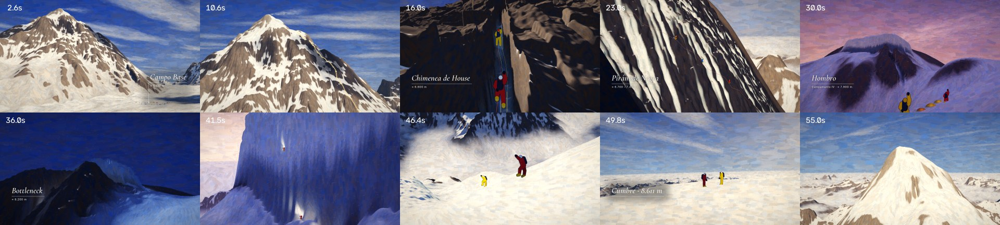

# K2 · Espolón de los Abruzos

Animación cinematográfica de **56 s** que sigue la ruta normal del K2 (8.611 m) por el
**Espolón de los Abruzos**, vertiente paquistaní: del Campo Base sobre el glaciar
Godwin-Austen a la cumbre, pasando por la Chimenea de House, la Pirámide Negra, el Hombro
(Campamento IV), el Bottleneck bajo el serac y su travesía, y la arista final.



| Archivo | Contenido |
|---|---|
| `output/K2_Espolon_de_los_Abruzos.mp4` | **Pieza principal.** 1920×1080, 24 fps, H.264 (2 pasadas, ~13 Mbps) + AAC 48 kHz; pista de subtítulos en español activable |
| `output/K2_Espolon_de_los_Abruzos_subtitulado.mp4` | La misma pieza con los subtítulos incrustados (para reproductores sin pista de subtítulos) |
| `output/K2_Espolon_de_los_Abruzos.srt` | Subtítulos: transcripción fiel de la narración, cortados en las pausas reales de la voz |
| `output/alta_calidad/K2_Espolon_de_los_Abruzos_master.mp4` | Máster 1080p (CRF 15, ~45 Mbps) — en Git LFS |

## Estructura

| Tiempo | Plano | Luz | Lo que cuenta |
|---|---|---|---|
| 0–6,6 s | Glaciar Godwin-Austen, K2 y **Campo Base** | mañana | escala y aislamiento; penacho de nieve en la cumbre |
| 6,6–13,2 s | Grúa que descubre el **Espolón**; la ruta se dibuja sola | mañana | trazado completo, con los campamentos |
| 13,2–19 s | **Chimenea de House** (≈ 6.600 m) | mediodía | dos escaladores con jumar en la fisura, cuerdas fijas |
| 19–27 s | **Pirámide Negra** (≈ 6.700–7.400 m) | tarde | teleobjetivo: tres escaladores en la roca oscura, el vacío y el mar de nubes |
| 27–33 s | **Hombro / Campamento IV** (≈ 7.900 m) | atardecer | tiendas, viento y nieve en polvo; el serac ya a la vista |
| 33–38,8 s | **Bottleneck** (≈ 8.200 m) | noche | la hilera de frontales sube el corredor bajo el serac |
| 38,8–44,4 s | **Travesía** bajo la pared de hielo | alba | el tramo más expuesto, hacia la izquierda |
| 44,4–48,2 s | Arista final | mañana | último esfuerzo sobre el mar de nubes |
| 48,2–51,2 s | **Cumbre · 8.611 m** | mañana | el Karakórum alrededor |
| 51,2–56 s | Alejamiento | mañana | los escaladores, motas en la cima; la línea del descenso aparece |

La expedición se resume con la luz: del día en el Campo Base al atardecer del
Campamento IV, la noche del ataque a cumbre, el alba en la travesía y la mañana arriba.

## Cómo está hecha

La técnica es la de la **rotoscopia pictórica**: primero se "rueda" una referencia y
luego se pinta encima, fotograma a fotograma.

1. **Geografía real.** El relieve es el modelo digital de elevación *Copernicus GLO-30*
   (ESA, 30 m) de 3×3 grados alrededor del K2, reproyectado a un marco local centrado
   en la cumbre, con curvatura terrestre y refracción. La ruta sigue la cresta del
   espolón trazada sobre el DEM (C1 ≈ 6.050 m, Chimenea de House ≈ 6.600 m,
   C2 ≈ 6.700 m, Pirámide Negra, C3 ≈ 7.400 m, Hombro ≈ 7.700–8.000 m). Por encima del
   Hombro se esculpió la pirámide cimera según las descripciones de la ruta: el
   corredor del Bottleneck (~8.200 m) entre contrafuertes de roca, el serac colgante,
   la travesía **hacia la izquierda** bajo la pared de hielo y la arista nevada hasta
   8.611 m (la cumbre del DEM, 8.572 m, se elevó a la cota medida).
2. **Referencia** (`src/raymarch.py`, `src/scene.py`): trazador de rayos sobre campos
   de alturas anidados (100 m → 10 m → 2,5 m → 0,3 m en primeros planos y una pared de
   granito fracturado para la Chimenea), sombras suaves, cielo y perspectiva aérea
   según la hora, mar de nubes volumétrico y penacho de nieve en la cumbre.
3. **Pintura** (`src/painter.py`, `src/brushes.py`): cada pincelada es una partícula
   anclada a un punto del terreno (o a una dirección del cielo). En cada fotograma se
   reproyecta con la cámara, se retiran las ocultas y se rellenan los huecos. Las
   pinceladas siguen contornos y línea de máxima pendiente, toman el color de la
   referencia y se vuelven a pintar **cada dos fotogramas** (*on twos*): la textura
   "hierve" sutilmente, como en la animación pintada a mano. Cuatro capas de pincel,
   lienzo de lino y relieve de empaste.
4. **Personajes** (`src/figures.py`): escaladores 2D animados con volumen (traje de
   plumas, mochila, casco, gafas, manoplas, crampones), iluminados con la luz de la
   escena y repintados con pinceladas; cuerdas fijas, tiendas, frontales y sus haces.
5. **Montaje** (`src/compose.py`): transiciones pintadas con pinceladas de cerdas en la
   dirección del relato (de abajo arriba en el ascenso, la noche cae desde el cielo,
   la travesía entra hacia la izquierda, la cumbre florece desde el pico), rótulos
   tipográficos (Cormorant Garamond + Inter) y fundidos.

### Sonido
* **Narración** en español latinoamericano: voz neuronal Piper `es_MX-claude-high`
  (fonemas es-419, con seseo) vía sherpa-onnx. Cada frase se generó en varias tomas y
  se eligió la más clara transcribiéndola con Whisper *dentro de la mezcla final*
  (`src/audio/retake_in_mix.py`). Cadena de voz: paso alto, ecualización, de-esser,
  compresor 3:1 y una sala muy corta.
* **Música original** (`src/audio/music.py`), en re menor, interpretada con las
  muestras orquestales **VSCO-2 Community Edition (CC0)**: bordón y arpa al inicio, tema
  de la ruta (i–VI–III–VII) mientras se dibuja la línea, pulso de spiccato en la
  Chimenea, trompas y timbales en la Pirámide Negra, respiración contenida en el
  Hombro, ostinato cromático y latido de timbal en el Bottleneck, crescendo en la
  travesía, re mayor en la cumbre y una quinta vacía al final: aún queda bajar.
* **Diseño sonoro** sintetizado (`src/audio/sfx.py`): viento de altura con ráfagas,
  nieve en polvo, crampones, jumars y mosquetones, lona de tiendas, respiración y el
  crujido del hielo (el serac cruje; nada cae).
* **Mezcla** (`src/audio/mixdown.py`): la música baja bajo la voz y cada frase queda al
  menos 11 dB por encima del fondo; máster a −16 LUFS integrados, techo −1 dBTP.

### Control de calidad
* Inteligibilidad: Whisper transcribe la narración **sobre la mezcla final** con un
  5 % de error de palabras (los errores restantes son nombres propios: «Abruzos»).
* Sonoridad: −16,0 LUFS integrados, rango 3,2 LU.
* Subtítulos sincronizados por frase y partidos en las pausas reales de la voz.

## Rigor y licencias
* Las alturas de los rótulos son aproximadas (`≈`), como en las fuentes; la posición de
  los campamentos cambia cada temporada.
* No se muestran peligros ni accidentes ficticios.
* Datos y recursos: Copernicus DEM GLO-30 (© DLR e.V. 2010-2014 y © Airbus Defence and
  Space GmbH 2014-2018, proporcionado bajo COPERNICUS por la Unión Europea y la ESA);
  VSCO-2 CE (CC0); voz Piper `es_MX-claude-high` (Apache-2.0); Whisper (MIT);
  tipografías Cormorant Garamond e Inter (SIL OFL).

## Reconstruir
Requiere ~4 núcleos, 16 GB de RAM y unas 3 h de render.
```bash
pip install numba scipy opencv-python-headless rasterio sherpa-onnx soundfile librosa pyloudnorm
python3 src/terrain_build.py      # DEM (9 teselas GLO-30 en /home/user/k2data/dem) -> rejillas locales
python3 src/audio/narration.py    # voz (modelos Piper y Whisper de sherpa-onnx)
python3 src/audio/music.py && python3 src/audio/sfx.py && python3 src/audio/mixdown.py
cd src
python3 render.py groups basecamp+spur ridge &          # tres colas reanudables
python3 render.py groups pyramid bottleneck chimney &
python3 render.py groups traverse summit+pullback shoulder &
wait && python3 compose.py && python3 encode.py && python3 qa.py
```
Herramientas de desarrollo: `preview_all.py` (hoja de fotogramas por plano),
`preview_film.py` (previsualización rápida sin pintar), `camtest.py` (encuadres).
