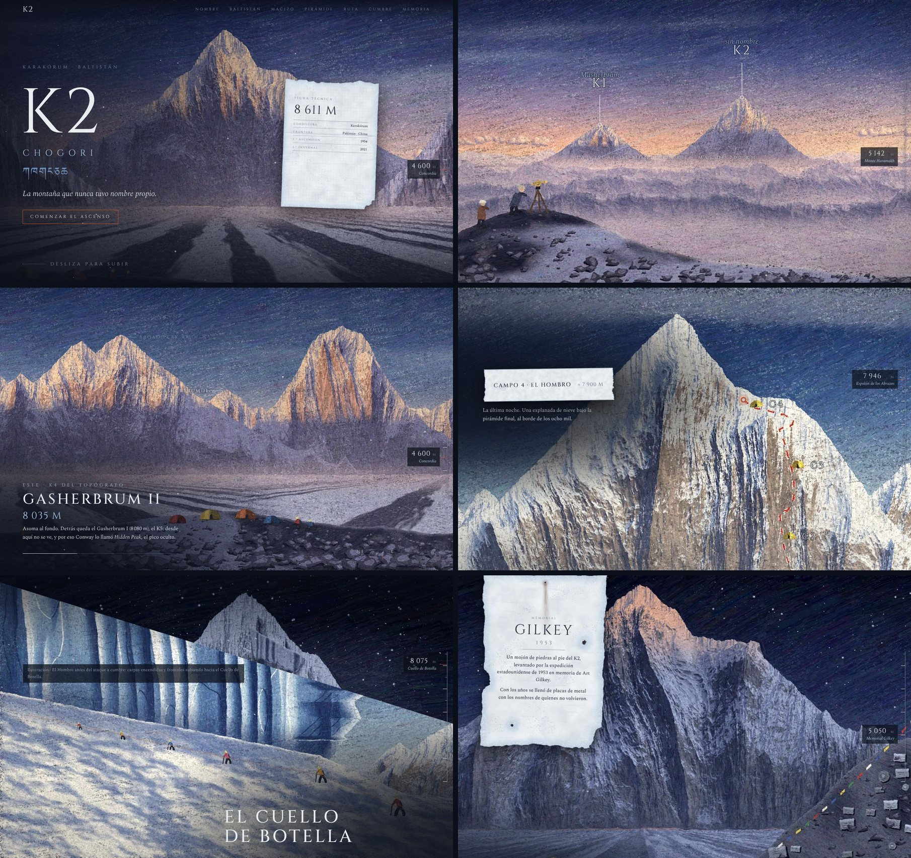
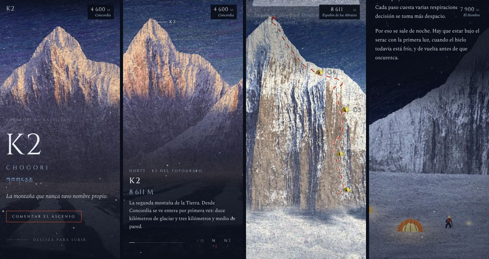

# K2 · La montaña sin nombre

Web *scrollytelling* sobre el K2: se lee subiendo. Empieza en Concordia, pasa por el nombre que
nunca tuvo, la gente de Baltistán, los picos que lo rodean, la pirámide de 8 611 m y la ruta del
Espolón de los Abruzos, y termina en el Memorial Gilkey. Sigue la identidad visual **«Epitafio»**
(Cinzel, Spectral, Jomolhari; Noche, Granito, Nieve y una única Señal cálida) y usa como fondo, de
principio a fin, ilustraciones a pincel seco pintadas por código.





## Verla

No hay nada que instalar ni que compilar: es HTML, CSS y JavaScript sin dependencias.

```bash
cd k2-epitafio
python3 -m http.server 8000        # o cualquier servidor de archivos estáticos
# → http://localhost:8000
```

(Hace falta un servidor porque el JavaScript son módulos ES; abrir `index.html` con doble clic no
los carga.)

## Qué cuenta

| Capítulo | Lámina de fondo | Qué pasa al bajar |
|---|---|---|
| Portada | Concordia al amanecer | La cámara se asienta sobre la pirámide; ficha técnica en papel |
| El nombre | El Karakórum desde el Haramukh, 1856 *(nueva)* | Se traza la visual del teodolito y aparecen los rótulos K1 y K2 |
| Baltistán | Porteadores en el Baltoro *(nueva)* | La escena entra recortada con la silueta del K2; el altímetro sube de Askole a Concordia |
| El macizo | Panorámica de Concordia, 7 200 px *(nueva)* | La cámara gira de norte a sur parándose en siete picos, con brújula y ficha de cada uno |
| La pirámide | Campo base | Anotaciones dibujadas sobre la cara sur; cifras que cuentan |
| La ruta | Vista aérea del espolón *(repintada en dos capas)* | La línea roja se destapa campo a campo, la cámara la sigue y el altímetro marca la altitud |
| La noche | Campo 4 | Carpas y frontales titilan; visión en túnel que sigue al puntero |
| El cuello de botella | El serac | Entra por una diagonal con la pendiente de la ladera; ventisca |
| Cumbre | Cumbre | Se abre en iris desde el alpinista de la cima; cronología en tiras de papel |
| Memoria | Memorial Gilkey al anochecer *(nueva)* | El altímetro baja; la cifra fatal en Señal |
| Epílogo | Concordia otra vez | La misma lámina del principio, ya de noche |

## Cómo está hecha

- **Escenario fijo y contenido que sube.** Las láminas viven en un `#escenario` fijo; el texto y
  los papeles se desplazan por encima con el scroll nativo. No se secuestra la rueda: lo que se
  suaviza es la posición que leen las animaciones (`js/reloj.js`), así el texto responde al
  instante y el escenario lo sigue con una inercia corta.
- **Transiciones gobernadas por una variable.** Cada escena tiene `--w` (1 = fuera, 0 = dentro) y
  el CSS decide la forma de entrar: fundido, telón, diagonal, iris o la silueta del K2 subiendo
  (`clip-path` con `calc()`). JavaScript solo escribe ese número (`js/escenario.js`).
- **Cámara por fotogramas clave.** Cada capítulo declara dónde mira la lámina (foco y escala) a lo
  largo de su avance, con una variante `ancha` y otra `estrecha`: en vertical la lámina es mucho
  más ancha que la pantalla y la cámara la recorre en lugar de recortarla.
- **La ruta está pintada, no dibujada.** La escena se pinta dos veces, con y sin línea, sembrando
  igual el acabado: las dos imágenes son idénticas píxel a píxel salvo en lo añadido. La diferencia
  se recorta como capa con transparencia (63 KB) y en la web se destapa con una máscara SVG que
  recorre el mismo trazado (`js/ruta.js`). La línea conserva así la pincelada y el grano del resto.
- **Papeles con proporción fija.** Las siete plantillas usadas nunca se estiran; la letra escala
  con el ancho de la hoja mediante unidades de contenedor (`cqw`), y la «nota de campo» ajusta su
  interlineado a los renglones pintados.
- **Altímetro.** El margen derecho traduce el avance de la lectura a metros: cada capítulo declara
  su altitud y en la ruta se calcula a partir del punto de la línea.
- **Nieve.** Un canvas entre las láminas y el texto; cada capítulo fija intensidad y viento, y el
  scroll arrastra los copos según su profundidad (`js/nieve.js`).

### Estructura

```
index.html              contenido y escenas
css/k2.css              identidad, maquetación y entradas de escena
css/lqip.css            marcadores de carga de 40 px (generado)
js/main.js              arranque
js/reloj.js             medidas, scroll suavizado y reparto de cada cuadro
js/escenario.js         escenas, transiciones, cámara y carga diferida
js/ruta.js              la ruta: máscara, cámara de seguimiento y altitud
js/panoramica.js        el giro de Concordia
js/altimetro.js · nieve.js · noche.js · texto.js · cabecera.js · util.js
js/datos.js             trazado de la ruta (generado)
assets/img/             ilustraciones en WebP (960, 1600, 2560 y 3840 px; panorámica hasta 7 200)
assets/papel/           plantillas de papel de la identidad
assets/fuentes/         subconjuntos WOFF2 y licencias OFL
herramientas/           todo lo necesario para regenerar los activos
```

### Accesibilidad y rendimiento

- Con `prefers-reduced-motion` no hay inercia, nieve ni entradas animadas; las escenas cambian en seco.
- Sin JavaScript el texto completo queda visible sobre la primera lámina.
- Las láminas son decorativas (`aria-hidden`); cada capítulo lleva su pie de ilustración en el texto.
- Enlace «Saltar al contenido», foco visible, menú con `aria-current`.
- Las ilustraciones se piden a medida que se acercan y en el ancho que la pantalla necesita.
  Recorrido completo a 1440 × 900: 7 MB (2,6 MB de carga inicial).
- Medido con Playwright recorriendo toda la página en Chromium sin GPU: 16,7 ms de mediana por
  cuadro, ninguna tarea larga, ningún error de consola (escritorio y móvil).

## Ilustraciones

Las seis láminas originales de la identidad se regeneraron sin pérdida con su propio motor
(`herramientas/pintura/`). Con ese mismo motor se pintaron cinco más, para que todo el fondo
comparta trazo, grano y paleta:

| Lámina | Escena | Para qué |
|---|---|---|
| `k2_03_ruta` + `k2_03_ruta_linea` | `ruta_placa`, `ruta_linea` | La ruta en dos capas |
| `k2_07_horizonte` | `horizonte` | El K1 y el K2 vistos desde el Haramukh, con el teodolito |
| `k2_08_baltoro` | `baltoro` | Porteadores baltís glaciar arriba, entre torres de granito |
| `k2_09_anfiteatro` | `anfiteatro` | Panorámica 3,6:1 de Concordia al atardecer |
| `k2_10_gilkey` | `gilkey` | El memorial, con la última luz en la cumbre |

Para repetirlo desde cero (unos 20 minutos y 5 GB de RAM como máximo):

```bash
pip install numpy scipy pillow fonttools brotli
cd herramientas/pintura
python3 scenes.py concordia 3840 2160 ../../masters/k2_01_concordia.png 2     # …y las otras cinco
python3 extra.py  anfiteatro 7200 2000 ../../masters/k2_09_anfiteatro.png 2 --meta ../../masters/k2_09_anfiteatro.json
# ver herramientas/pintura/LEEME.md para la lista completa
cd ..
python3 activos.py ../masters <carpeta de la identidad> ../assets
```

`activos.py` produce los WebP responsivos, la capa de la ruta, los marcadores de carga, los
subconjuntos de fuentes, los papeles a tamaño web y `js/datos.js`.

## Empaquetarla en un solo HTML

```bash
python3 herramientas/pagina_unica.py salida/index.html        # necesita esbuild (npx)
```

Incrusta CSS, fuentes y JavaScript en un único archivo; las imágenes siguen en `assets/`. Con
`--fragmento` omite el esqueleto del documento, para alojamientos que ya lo ponen.

## Sobre los datos

Las altitudes de los campos son aproximadas y cambian con cada temporada. Las cifras de cumbres y
fallecidos varían según la base de datos (el texto lo dice así). La cita de Fosco Maraini circula
en inglés a partir de su libro sobre el Gasherbrum IV; la traducción es propia. El tibetano es
decorativo: son consonantes del alfabeto, no palabras, como pide la identidad. Las ilustraciones
son interpretativas: rumbos, distancias y trazado de la ruta son aproximados.

Fuentes consultadas: Wikipedia (K2, pueblo balti, expedición estadounidense de 1953),
ExplorersWeb (los nombres «K») y las crónicas de Alan Arnette.

## Licencias

Tipografías Cinzel, Spectral y Jomolhari bajo SIL Open Font License (`assets/fuentes/OFL-*.txt`).
