# Storyboard final

Fotogramas reales del render 4K, reducidos a 960 × 540. Cada viñeta corresponde exactamente al
corte final; los tiempos detallados están en [guion.md](guion.md).

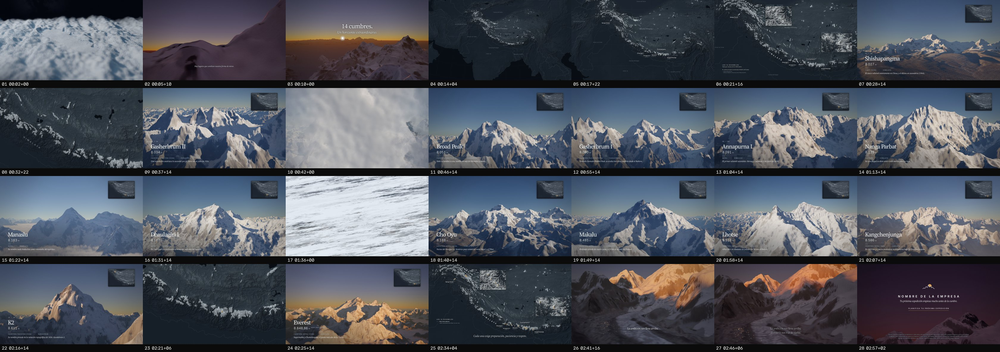

## Apertura

### 01 · 00:02+00 · f 48 · Apertura

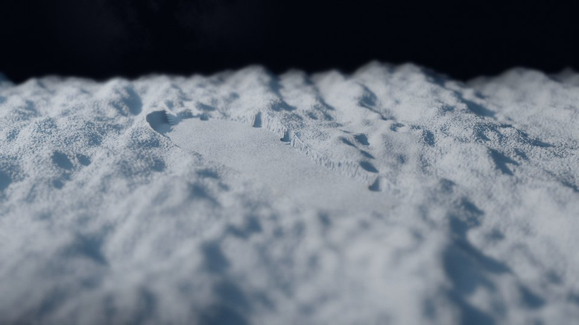

- **Imagen:** Macro: la frontal descubre la huella de un crampón de 12 puntas en la costra de nieve.
- **Texto en pantalla:** ninguno
- **Sonido:** Viento, paso de crampón, respiración

### 02 · 00:05+10 · f 130 · Apertura

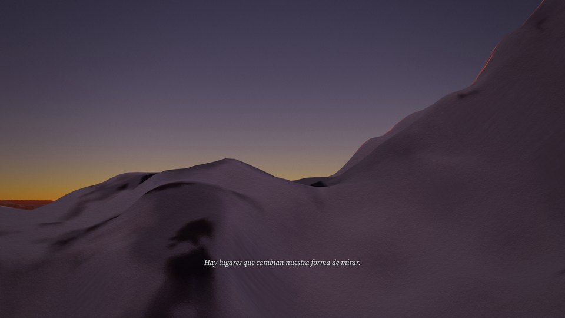

- **Imagen:** Subida en hora azul hacia el Collado Sur del Everest.
- **Texto en pantalla:** Hay lugares que cambian nuestra forma de mirar.
- **Sonido:** Dron grave, aire

### 03 · 00:10+00 · f 240 · Apertura

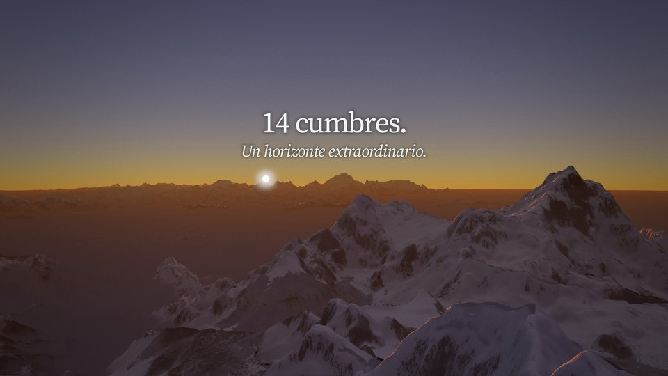

- **Imagen:** Amanecer sobre el horizonte oriental (sol a 98°).
- **Texto en pantalla:** 14 cumbres. / Un horizonte extraordinario.
- **Sonido:** Golpe con el sol (f 180), entra re menor

## Mapa regional

### 04 · 00:14+04 · f 340 · Mapa

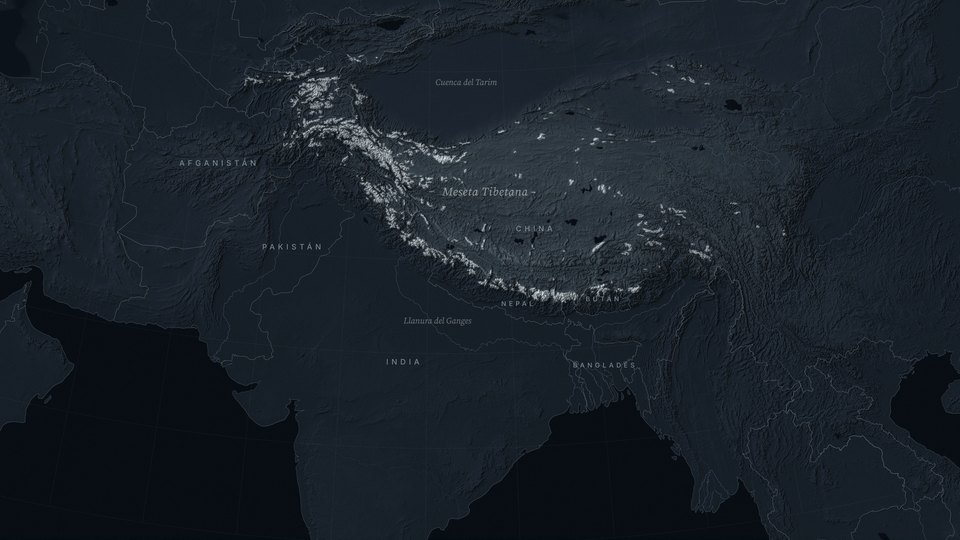

- **Imagen:** Asia en proyección cónica de Lambert con relieve sombreado y topónimos.
- **Texto en pantalla:** Topónimos
- **Sonido:** Aparece el pulso

### 05 · 00:17+22 · f 430 · Mapa

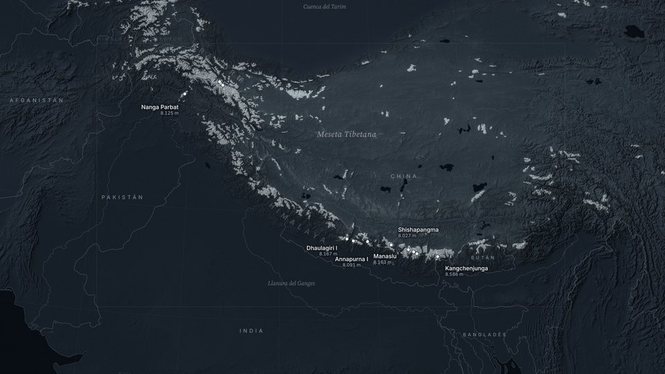

- **Imagen:** Zoom al arco: los 14 marcadores ya encendidos, rótulos de cordillera.
- **Texto en pantalla:** Nombres y altitudes
- **Sonido:** Arpegio de 14 notas (c. 6)

### 06 · 00:21+16 · f 520 · Mapa

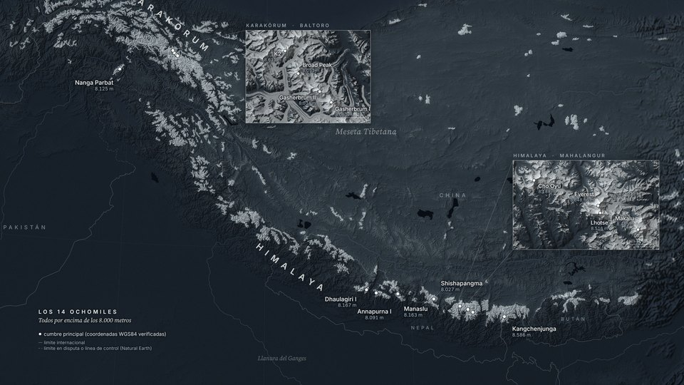

- **Imagen:** Recuadros del Baltoro y del Mahalangur, leyenda; los 14 puntos visibles 5,8 s.
- **Texto en pantalla:** LOS 14 OCHOMILES · Todos por encima de los 8.000 metros

## Las 14 cumbres

### 07 · 00:28+14 · f 686 · Capítulo 01

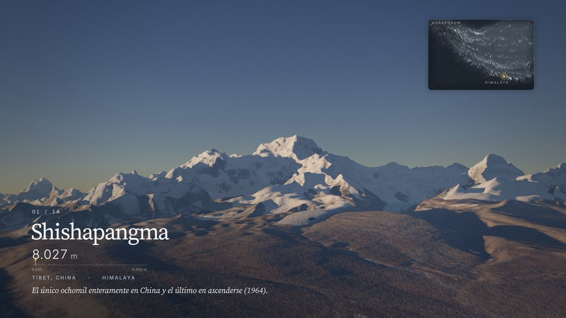

- **Imagen:** Shishapangma desde la meseta tibetana, sol bajo del este.
- **Texto en pantalla:** 01 / 14 · Shishapangma · 8.027 m
- **Sonido:** Golpe de membrana, motivo

### 08 · 00:32+22 · f 790 · Transición

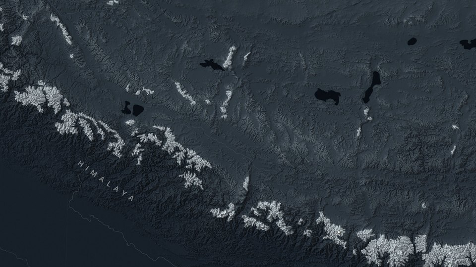

- **Imagen:** Salto por el mapa entre Shishapangma y Gasherbrum II.
- **Texto en pantalla:** ninguno
- **Sonido:** Silbido de subida y bajada

### 09 · 00:37+14 · f 902 · Capítulo 02

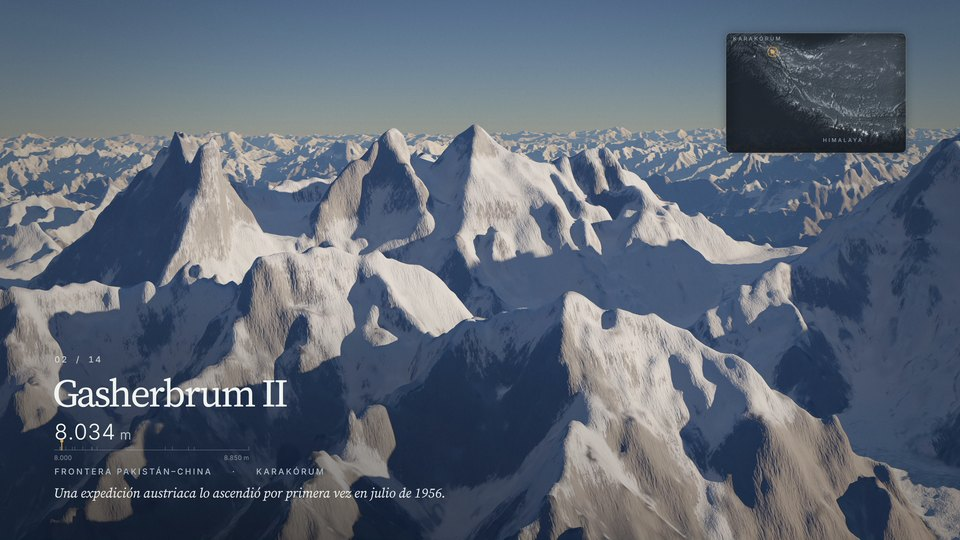

- **Imagen:** Gasherbrum II: la cámara alza la vista desde el glaciar.
- **Texto en pantalla:** 02 / 14 · Gasherbrum II · 8.034 m

### 10 · 00:42+00 · f 1008 · Transición

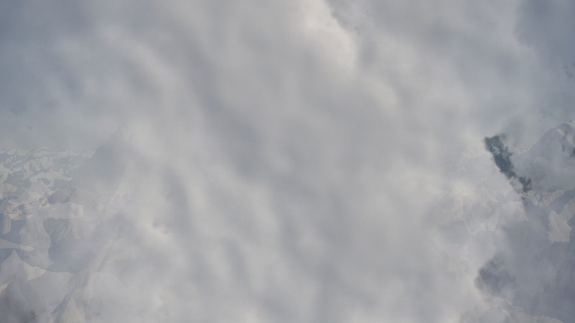

- **Imagen:** Cortinilla de nube entre Gasherbrum II y Broad Peak.
- **Texto en pantalla:** ninguno
- **Sonido:** Soplo

### 11 · 00:46+14 · f 1118 · Capítulo 03

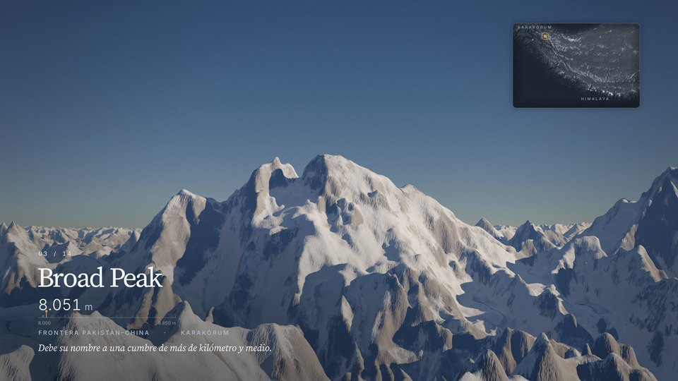

- **Imagen:** Broad Peak: travelling a lo largo de la cresta cimera.
- **Texto en pantalla:** 03 / 14 · Broad Peak · 8.051 m

### 12 · 00:55+14 · f 1334 · Capítulo 04

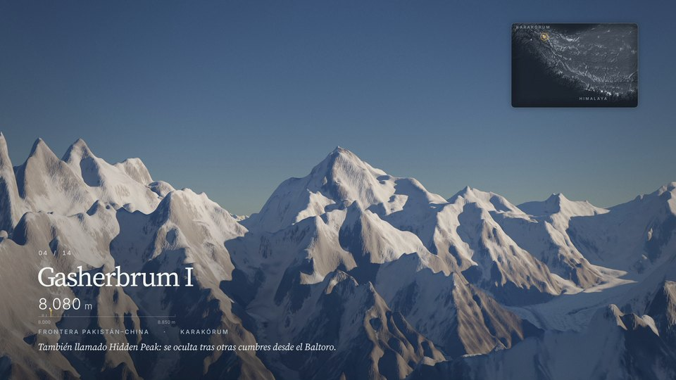

- **Imagen:** Gasherbrum I aparece tras las cumbres del Baltoro.
- **Texto en pantalla:** 04 / 14 · Gasherbrum I · 8.080 m

### 13 · 01:04+14 · f 1550 · Capítulo 05

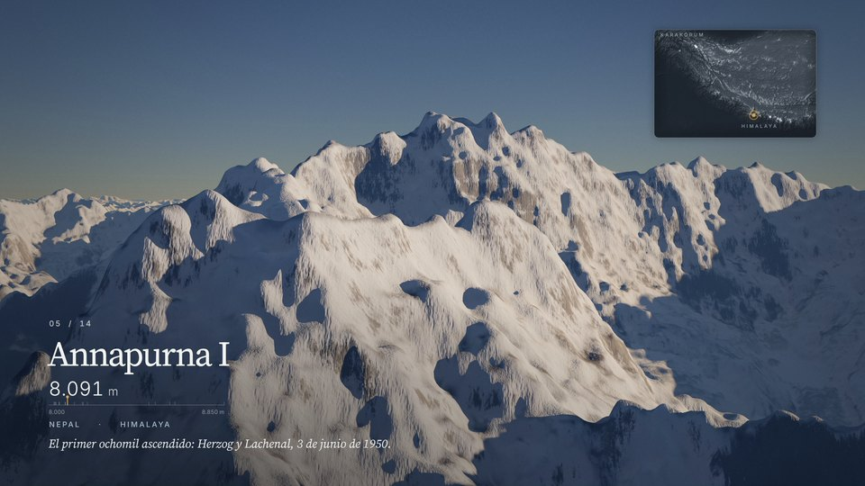

- **Imagen:** Annapurna I: la pared sur con luz rasante de primera hora.
- **Texto en pantalla:** 05 / 14 · Annapurna I · 8.091 m

### 14 · 01:13+14 · f 1766 · Capítulo 06

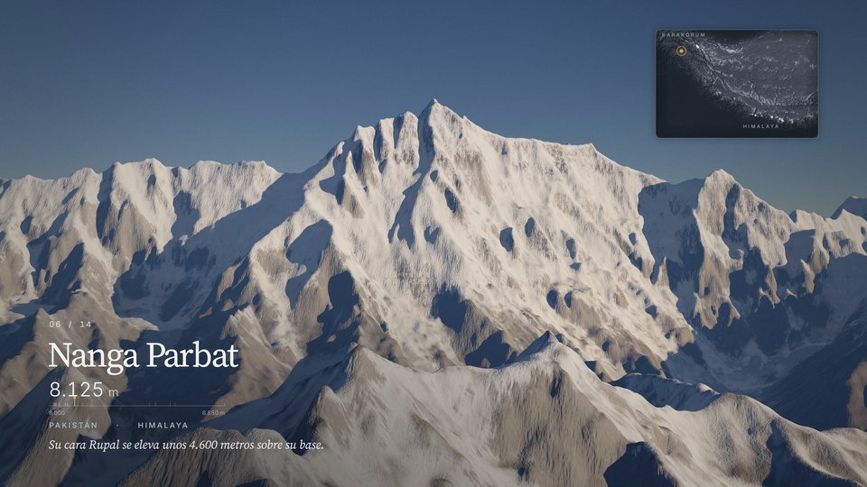

- **Imagen:** Nanga Parbat: la cara Rupal, de la base a la cima.
- **Texto en pantalla:** 06 / 14 · Nanga Parbat · 8.125 m

### 15 · 01:22+14 · f 1982 · Capítulo 07

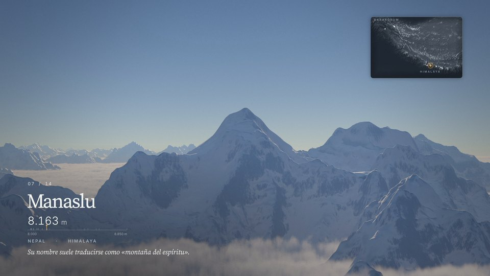

- **Imagen:** Manaslu a contraluz sobre un mar de nubes.
- **Texto en pantalla:** 07 / 14 · Manaslu · 8.163 m
- **Sonido:** Crece la densidad

### 16 · 01:31+14 · f 2198 · Capítulo 08

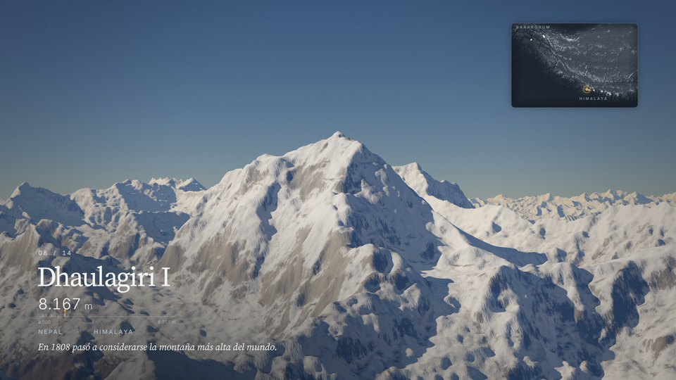

- **Imagen:** Dhaulagiri I en órbita lenta.
- **Texto en pantalla:** 08 / 14 · Dhaulagiri I · 8.167 m

### 17 · 01:36+00 · f 2304 · Transición

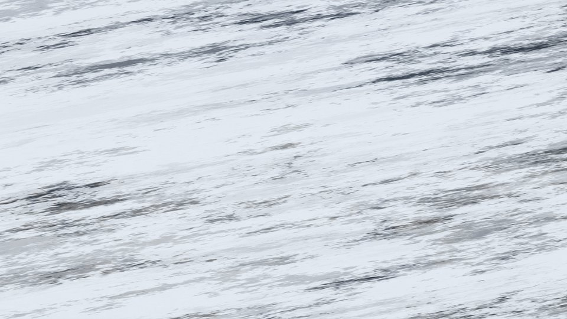

- **Imagen:** Ventisca entre Dhaulagiri I y Cho Oyu.
- **Texto en pantalla:** ninguno
- **Sonido:** Siseo de nieve

### 18 · 01:40+14 · f 2414 · Capítulo 09

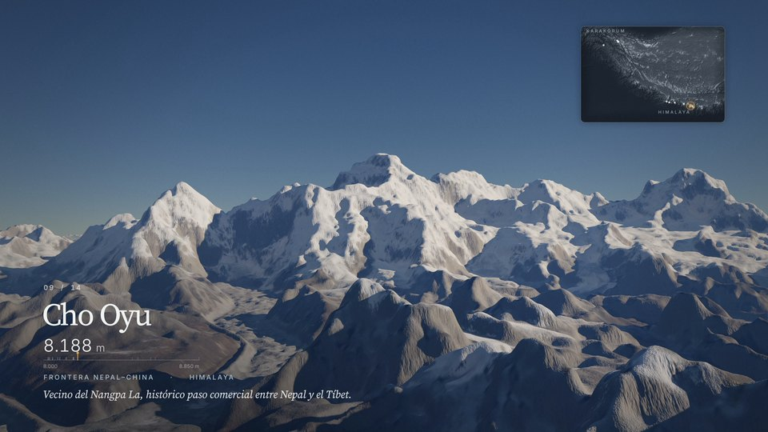

- **Imagen:** Cho Oyu: encuadre amplio, el respiro del ritmo.
- **Texto en pantalla:** 09 / 14 · Cho Oyu · 8.188 m
- **Sonido:** Cristal, sin golpe

### 19 · 01:49+14 · f 2630 · Capítulo 10

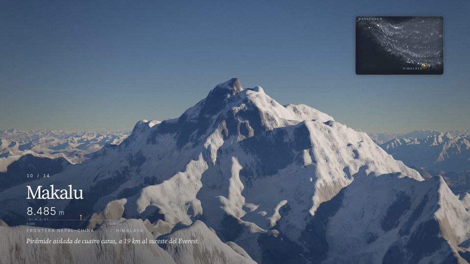

- **Imagen:** Makalu: pirámide de cuatro caras, luz y sombra.
- **Texto en pantalla:** 10 / 14 · Makalu · 8.485 m

### 20 · 01:58+14 · f 2846 · Capítulo 11

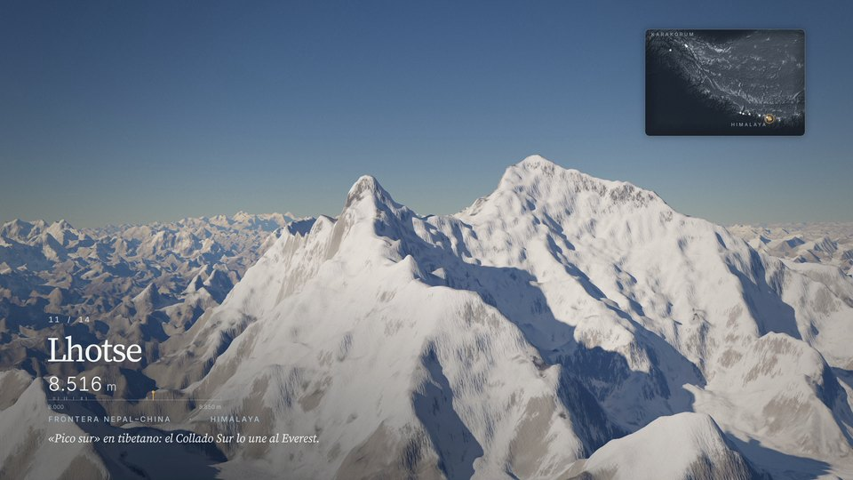

- **Imagen:** Lhotse desde el este, con el Everest detrás.
- **Texto en pantalla:** 11 / 14 · Lhotse · 8.516 m

### 21 · 02:07+14 · f 3062 · Capítulo 12

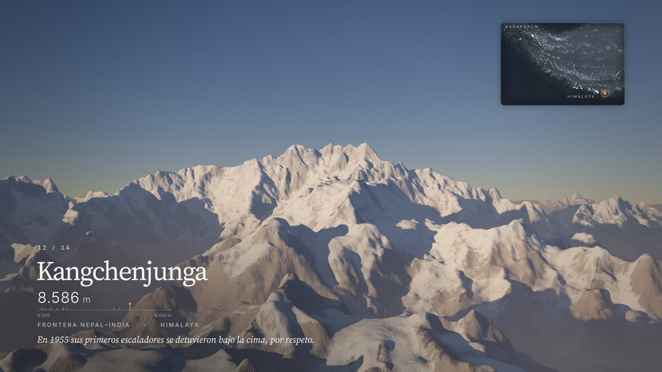

- **Imagen:** Kangchenjunga con luz dorada y nieblas en los valles.
- **Texto en pantalla:** 12 / 14 · Kangchenjunga · 8.586 m

### 22 · 02:16+14 · f 3278 · Capítulo 13

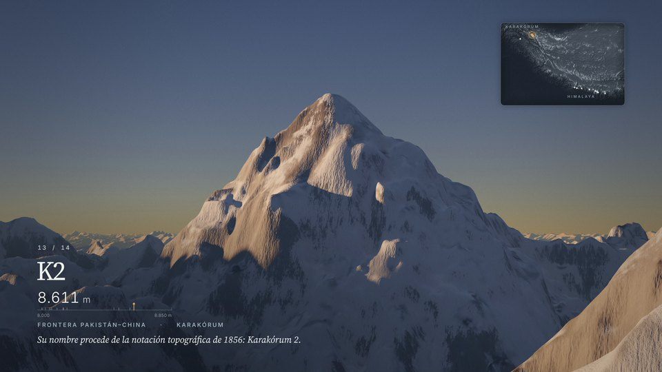

- **Imagen:** K2 sale del negro con luz de ocaso.
- **Texto en pantalla:** 13 / 14 · K2 · 8.611 m
- **Sonido:** Repliegue y golpe (c. 45)

### 23 · 02:21+06 · f 3390 · Transición

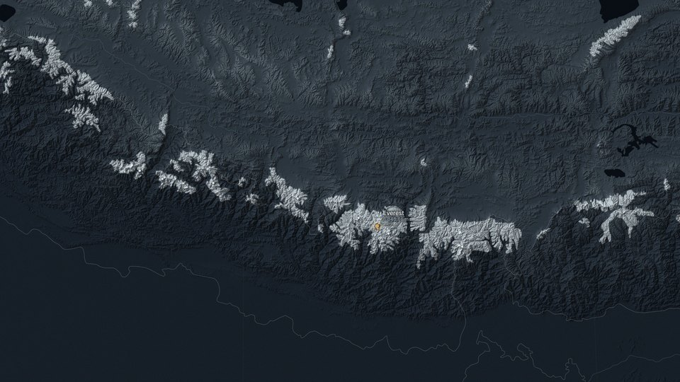

- **Imagen:** Gran salto sobre el mapa, del Karakórum al Khumbu.
- **Texto en pantalla:** ninguno
- **Sonido:** Subida, platillo invertido

### 24 · 02:25+14 · f 3494 · Capítulo 14

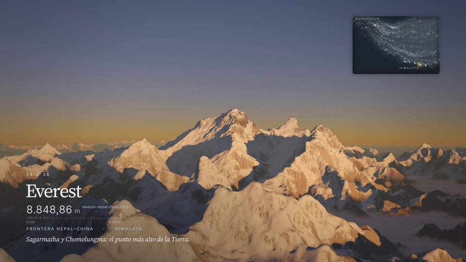

- **Imagen:** Everest en alpenglow: la cámara sube y revela.
- **Texto en pantalla:** 14 / 14 · Everest · 8.848,86 m
- **Sonido:** Re mayor (c. 48)

## Síntesis

### 25 · 02:34+04 · f 3700 · Síntesis

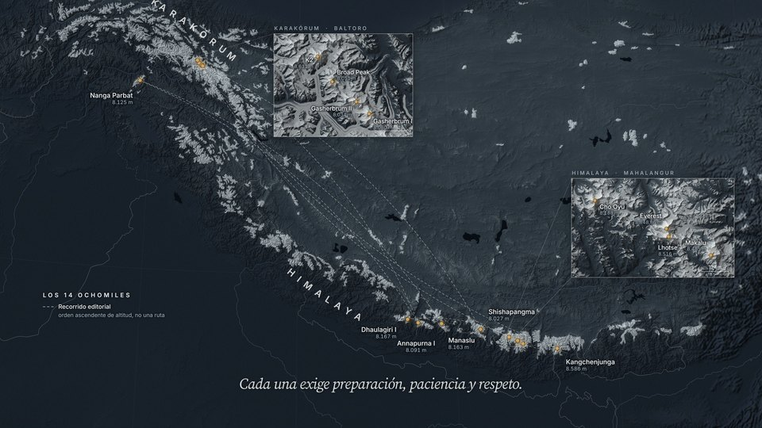

- **Imagen:** Mapa final: los 14 puntos en ámbar unidos por el recorrido editorial.
- **Texto en pantalla:** Recorrido editorial · orden ascendente de altitud, no una ruta / Cada una exige preparación, paciencia y respeto.
- **Sonido:** Resolución en re mayor

### 26 · 02:41+16 · f 3880 · Síntesis

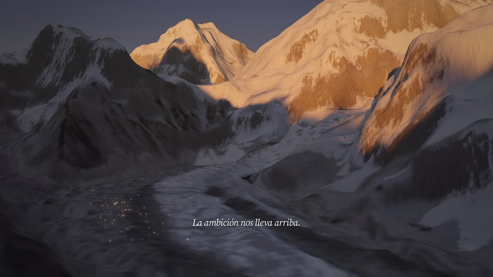

- **Imagen:** Campo base sur del Everest al atardecer: se encienden las luces del campamento.
- **Texto en pantalla:** La ambición nos lleva arriba.
- **Sonido:** Viento suave

### 27 · 02:46+06 · f 3990 · Síntesis

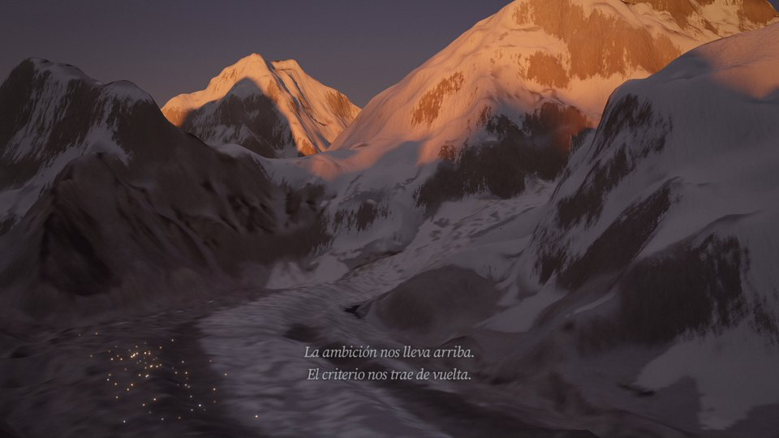

- **Imagen:** Luces de tienda (ilustrativas) sobre el glaciar bajo el alpenglow; la cámara empieza a subir.
- **Texto en pantalla:** La ambición nos lleva arriba. / El criterio nos trae de vuelta.

## Firma

### 28 · 02:57+02 · f 4250 · Firma

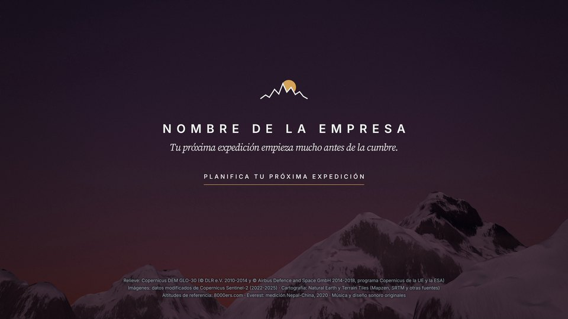

- **Imagen:** Marca provisional, nombre, lema y llamada a la acción; créditos de datos.
- **Texto en pantalla:** NOMBRE DE LA EMPRESA · Tu próxima expedición empieza mucho antes de la cumbre. · PLANIFICA TU PRÓXIMA EXPEDICIÓN
- **Sonido:** Golpe (c. 57), final en re mayor
