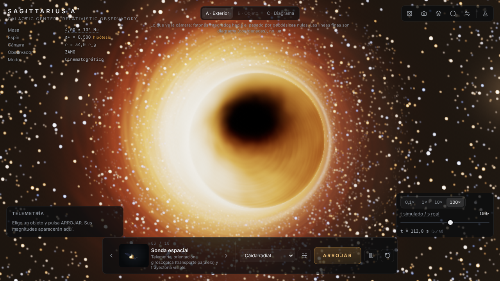
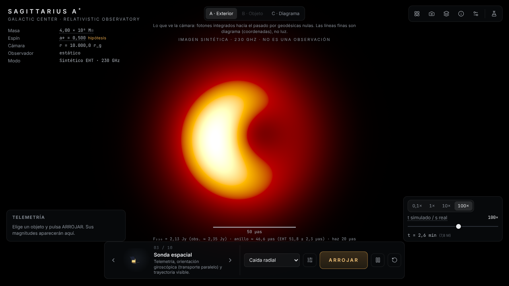
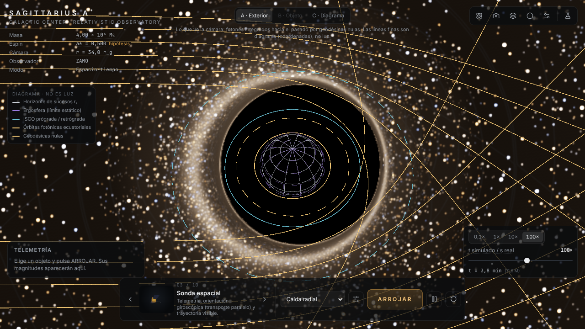
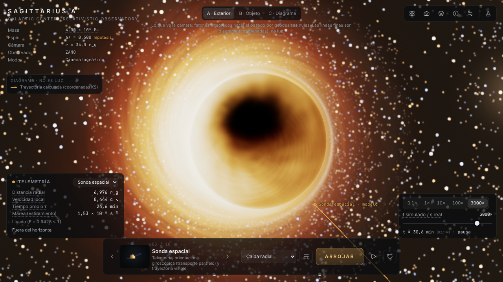
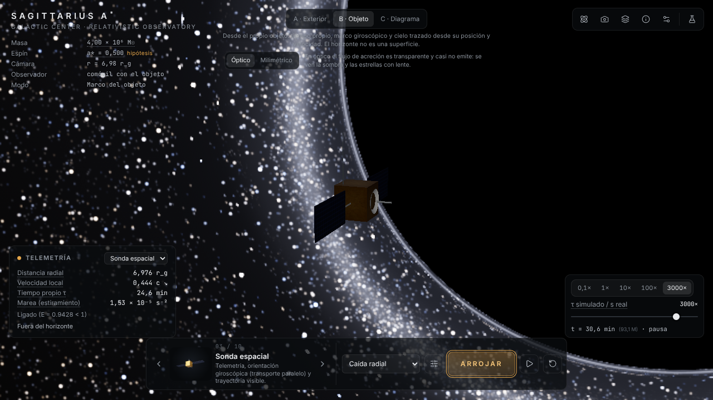
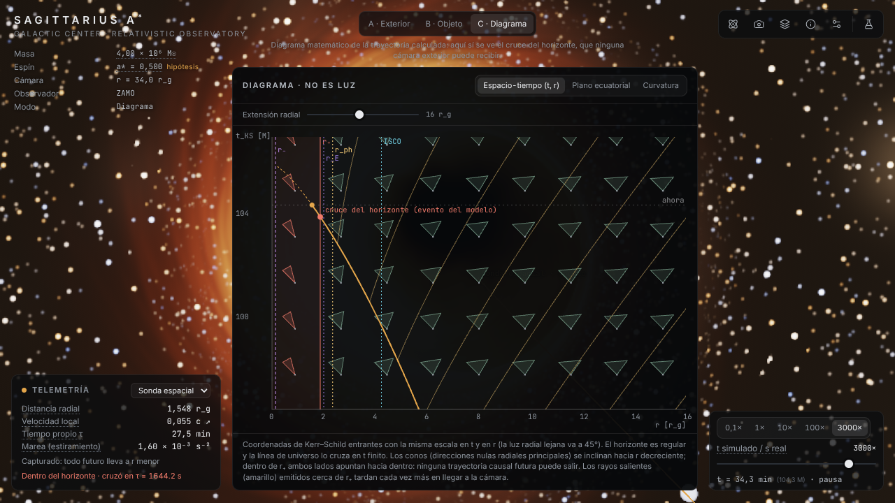
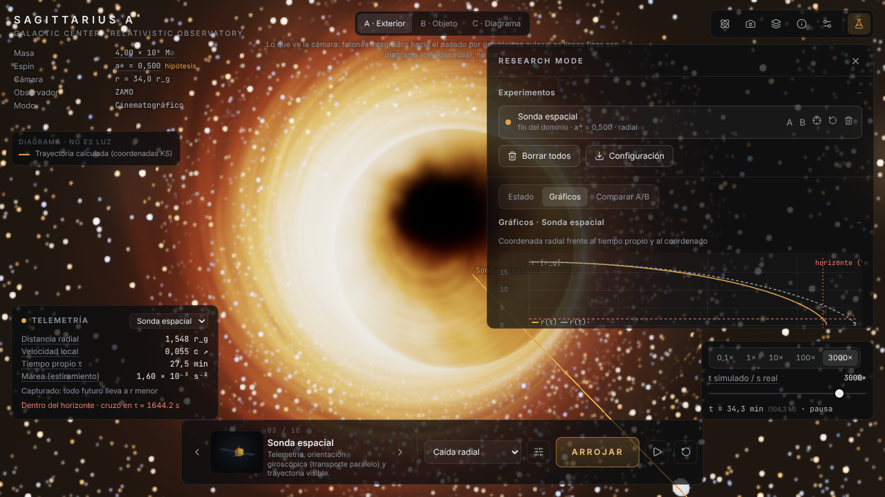

# SAGITTARIUS A* — Relativistic Observatory

Observatorio interactivo del agujero negro supermasivo del centro de la Vía Láctea, en el navegador.
Cada píxel es una **geodésica nula de Kerr** integrada en la GPU; cada objeto que arrojas sigue una
**geodésica temporal** integrada con Dormand–Prince; la marea sale del **tensor de Riemann**. Nada
se dibuja «a mano»: la sombra, el anillo de fotones, la lente del cielo, el desplazamiento al rojo y
el cruce del horizonte emergen de las ecuaciones.



| | |
|---|---|
|  |  |
|  |  |
|  |  |

> Capturas reales de la aplicación (`npm run capturas`), generadas en un entorno **sin GPU**
> (SwiftShader) con escala de render reducida: en una GPU la imagen es más nítida.

## Abrir sin instalar nada

Abre **[`entrega/sagittarius-a.html`](entrega/sagittarius-a.html)** con doble clic: es la aplicación
completa en un único archivo, sin servidor ni conexión. Necesita un navegador con WebGL 2 y
aceleración por hardware (en un equipo sin GPU funciona, pero a ~1 fotograma por segundo).

## Instalar y ejecutar

Requisitos: Node ≥ 22.12 y un navegador con WebGL 2 y texturas de coma flotante (Chrome, Edge,
Firefox o Safari recientes, con aceleración por hardware).

```bash
cd sagittarius-a
npm install
npm run dev          # http://localhost:5180
npm run build        # dist/sagittarius-a.html: un único HTML autocontenido, sin red
```

Otros comandos:

| Comando | Qué hace |
|---|---|
| `npm test` | 67 pruebas de la física y la simulación (Vitest) |
| `npm run validar` | Informe cuantitativo de errores frente a soluciones exactas → `docs/validacion/fisica.{json,md}` |
| `npm run validar:gpu` | Trazador de la GPU frente a la referencia en CPU, en Chromium → `docs/validacion/gpu.json` |
| `node scripts/recorrido.mjs <dir>` | Recorrido automático de la aplicación real con capturas y detección de errores |
| `npm run capturas` | Capturas reales para esta documentación → `docs/capturas/` |
| `npm run rendimiento` | Banco de pruebas en Chromium → `docs/validacion/rendimiento.json` |
| `npm run check` | lint + tipos + pruebas |

Parámetros de URL útiles: `?perfil=eht`, `?calidad=high`, `?escala=0.5` (escala de render fija),
`?ui=0` (sin interfaz), `?intro=0`, `?deriva=0`.

## Qué puedes hacer

**Tres perspectivas** (teclas 1, 2, 3):

- **A · Exterior:** lo que vería una cámara real. Los objetos se ven por la luz que llega de su línea
  de universo con tiempo retardado: al acercarse al horizonte su imagen se enrojece, se ralentiza y
  se apaga, sin desaparecer artificialmente.
- **B · Objeto:** cámara comóvil con el objeto, con su tiempo propio y su marco giroscópico. El objeto
  3D está a escala real; el cielo se traza desde su posición y velocidad. Cruza el horizonte en un
  tiempo propio finito: no hay pared, ni explosión.
- **C · Diagrama:** la línea de universo frente a la estructura causal (t, r) con conos de luz, el
  plano ecuatorial y un mapa de curvatura. Aquí sí se ve el cruce del horizonte, que ninguna cámara
  exterior puede recibir.

**Arrojarle cosas.** Diez objetos con física propia (catálogo rotativo con vista previa giratoria,
teclas `[` y `]`):

| # | Objeto | Demuestra |
|---|---|---|
| 1 | Esfera de acero | geodésica casi ideal; cruza el horizonte intacta |
| 2 | Reloj atómico | tiempo propio frente a coordenado; su baliza parpadea en tiempo propio |
| 3 | Sonda espacial | telemetría y orientación giroscópica (transporte paralelo) |
| 4 | Cápsula espacial | gradiente de marea proa–popa y tolerancia humana |
| 5 | Asteroide rocoso | rotura por marea cerca del horizonte (monolito) o lejos (agregado) |
| 6 | Cometa helado | disrupción por marea a ~30 r_g, fuera del horizonte |
| 7 | Contenedor de agua | el agua en el potencial de marea (dos lóbulos) frente a la capilaridad |
| 8 | Cubo reticulado | estiramiento y compresión; deformación elástica (ampliable) |
| 9 | Nube de partículas | geodésicas vecinas: estiramiento y dispersión |
| 10 | Haz de fotones | captura frente a escape en torno al parámetro crítico b_c |

Escenarios: caída radial, órbita (circular o excéntrica; nunca circular donde no existe), sobrevuelo,
captura, trayectoria crítica (a ±2·10⁻⁷ del separador) y personalizado. Las velocidades se definen en
el marco local de un observador estático o ZAMO y siempre son menores que c. El estado orbital se
decide con la energía y el momento angular crítico, nunca con la velocidad de escape newtoniana.

**Perfiles de visualización:**

- **Científico · EHT:** imagen sintética a 230 GHz desde la Tierra con haz instrumental opcional,
  barra de escala en μas, flujo total y diámetro del anillo medidos sobre la imagen frente a los del
  EHT (51,8 ± 2,3 μas). Etiquetada como sintética.
- **Cinematográfico:** la misma luz, con un tratamiento de color declarado artístico.
- **Espacio-tiempo:** sin plasma, con retícula celeste para ver la lente.

**SPACE-TIME GEOMETRY:** horizonte, ergosfera, ISCO, órbitas fotónicas, familias de geodésicas
calculadas (fotones, casi críticas, masivas, capturas), conos de luz, diagrama de incrustación y
rejilla. Todo marcado como diagrama, no como luz.

**Cámara:** órbita, vuelo libre (WASD + Q/E, Mayús para acelerar), seguimiento de objetos, enfoque,
restablecer, inercia; observadores estático, ZAMO, en órbita o en caída libre; y una caída libre
**física** de la cámara hacia el agujero (sin vuelta atrás salvo por un reinicio de software
declarado).

**Research Mode:** estado completo (t, τ, posición, u^μ, p_μ, E, L_z, Q y sus derivas numéricas,
Kretschmann, marea, tensión), gráficos de r(τ) y r(t), marea frente a τ, proyección de la órbita,
desplazamiento al rojo frente al tiempo de recepción (problema emisor–observador resuelto
numéricamente), comparación A/B, reinicio exacto y exportación CSV/JSON/PNG/configuración.

## Controles

| Acción | Ratón / táctil | Teclado |
|---|---|---|
| Orbitar / mirar | arrastrar · un dedo | A/D giran (órbita) |
| Desplazar | botón derecho o Mayús + arrastrar · dos dedos | — |
| Acercar | rueda · pellizcar | W/S |
| Zoom óptico | Alt + rueda | — |
| Vuelo libre | — | WASD, Q/E, Mayús |
| Pausa | botón ⏸ | Espacio |
| Restablecer cámara | Cámara → Restablecer | R |
| Seguir objeto / enfocar | Cámara | F / C |
| Arrojar · cambiar objeto | ARROJAR · flechas del catálogo | T o Intro · [ ] |
| Perspectivas | selector superior | 1 · 2 · 3 |
| Research Mode · ocultar interfaz | botones superiores | I · H |

## Física, en una tabla

| Elemento | Clase |
|---|---|
| Métrica de Kerr (Kerr–Schild), geodésicas, constantes E/L_z/Q, horizontes, ISCO, cruce del horizonte, Riemann y marea, señal recibida | **exacto** (error medido ≤ 10⁻⁹ en los casos de referencia) |
| Trazado en GPU (RK4 float32), transferencia radiativa, desviación geodésica de los fragmentos | **aproximado** (error medido: ~10⁻⁶ rad mediano) |
| Flujo de acreción RIAF, sincrotrón térmico, variabilidad, rotura, agua | **modelo** (no es GRMHD) |
| Balizas ampliadas, estrellas procedimentales, diagramas, forma de los fragmentos | **ilustrativo** |
| Paleta cinematográfica, bloom, ACES, sonido | **estético** |

Tabla completa: [docs/LIMITACIONES.md](docs/LIMITACIONES.md).

## Validación (resumen)

- 67 pruebas automáticas superadas.
- Caída radial: tiempo propio del cruce del horizonte frente a la cicloide exacta: 3·10⁻¹³ relativo.
- Precesión del periastro frente a la integral elíptica exacta: 6·10⁻¹².
- Constantes de Carter en Kerr (a = 0,9) tras 3000 M: deriva ≤ 8·10⁻¹².
- Kretschmann numérico frente al analítico, dentro y fuera del horizonte: ≤ 2,5·10⁻¹¹.
- GPU frente a CPU (1600 rayos por caso): acuerdo en captura/escape del 100 % (99,94 % en un caso:
  un rayo rasante al borde de la sombra); error angular mediano 10⁻⁷–2·10⁻⁶ rad; intensidad a
  230 GHz 0,14 % mediana; flujo total a 0,4 %.
- Imagen sintética EHT medida en la aplicación: anillo de 46,6–48,8 μas (EHT: 51,8 ± 2,3 μas) y flujo
  de 2,13–2,16 Jy (observado ≈ 2,35 Jy).

Detalles y método: [docs/VALIDACION.md](docs/VALIDACION.md).

## Rendimiento

Resolución dinámica (30–100 % de la ventana según el tiempo de fotograma), acumulación progresiva con
la cámara quieta, dos calidades (interactiva y alta fidelidad) y banco de pruebas integrado
(Ajustes → Rendimiento) que mide **tu** equipo. Las cifras medidas y cómo interpretarlas:
[docs/RENDIMIENTO.md](docs/RENDIMIENTO.md).

## Documentación

| Documento | Contenido |
|---|---|
| [docs/ARQUITECTURA.md](docs/ARQUITECTURA.md) | Módulos, flujo de un fotograma, hilos, determinismo |
| [docs/MATEMATICAS.md](docs/MATEMATICAS.md) | Ecuaciones: métrica, geodésicas, observadores, trazado, transferencia, RIAF, mareas, señal |
| [docs/VALIDACION.md](docs/VALIDACION.md) | Errores medidos y método |
| [docs/OBJETOS.md](docs/OBJETOS.md) | Los diez objetos: materiales, rotura y dónde se rompe cada uno |
| [docs/LIMITACIONES.md](docs/LIMITACIONES.md) | Clasificación de cada elemento y limitaciones |
| [docs/RENDIMIENTO.md](docs/RENDIMIENTO.md) | Medidas y estrategia de rendimiento |
| [docs/REFERENCIAS.md](docs/REFERENCIAS.md) | Bibliografía |

## Parámetros de Sgr A*

Masa 4,0 × 10⁶ M☉ y distancia 8,2 kpc (o el conjunto GRAVITY 2022: 4,297 × 10⁶ M☉, 8,277 kpc), con
fuentes. El **espín no está medido**: a* = 0,5 es una hipótesis de modelado, ajustable, y la
interfaz lo indica siempre.
